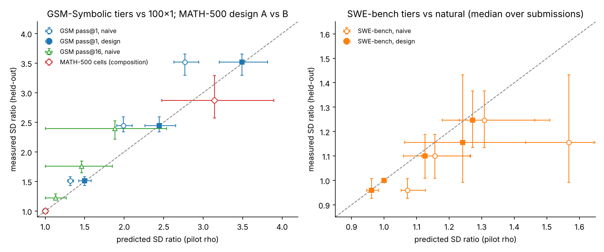

# Does a pilot estimate of rho predict the spread of a held-out evaluation?

Script: `scripts/analysis/deff_validation.py` (CPU, ~30 s). Outputs: `results/deff_validation/`
(`deff_summary.csv`, `table_deff.md`, `deff_splits.csv`, `swe_submission_icc.csv`, `deff_meta.json`,
`fig_deff_pred_vs_measured.png`).

Rule: SD ratio ≈ sqrt(1 + (m − 1) ρ), m = problems per source, ρ = intraclass correlation of the per-problem estimate.
ρ always comes from pilot data that are disjoint from the data used to measure the spread.

| benchmark | pilot (estimates ρ) | held out (measures SD) | repeats |
|---|---|---|---|
| GSM-Symbolic | 15/15/10 templates (main/P1/P2) × 4 variants × 16 attempts ≈ 160 problems | remaining 85/85/40 templates, four tiers, 1,000 draws each | 20 random splits |
| SWE-bench Verified | 10 random submissions | the other 119 submissions, five tiers, 300 draws each | 100 random pilot sets |
| MATH-500 | 150 random problems | the other 350, design A (redraw 12 of 35 cells) vs B (fixed cell mix) | 20 splits |

Two predictions: **naive** = the formula above; **design** = the variance of the actual sampling plan (stratified by
level, templates / repositories drawn without replacement, finite-population corrections, attempt noise), with
variance components from the pilot. Design is pass@1 only.

## Results (medians over splits; 90% range in `deff_summary.csv`)

| benchmark | tier | pilot ρ | naive | design | measured | iid coverage | coverage, iid × sqrt(naive deff) |
|---|---|---|---|---|---|---|---|
| GSM pass@1 | 50×2 | 0.73 | 1.32 | 1.50 | 1.51 | 0.92 | 0.98 |
| GSM pass@1 | 20×5 | 0.73 | 1.98 | 2.44 | 2.46 | 0.71 | 0.95 |
| GSM pass@1 | 10×10 | 0.73 | 2.75 | 3.48 | 3.52 | 0.53 | 0.93 |
| GSM pass@16 | 50×2 | 0.42 | 1.19 | — | 1.25 | 0.90 | 0.93 |
| GSM pass@16 | 20×5 | 0.42 | 1.64 | — | 1.76 | 0.75 | 0.87 |
| GSM pass@16 | 10×10 | 0.42 | 2.18 | — | 2.44 | 0.58 | 0.80 |
| SWE-bench | 8×5 | 0.037 | 1.07 | 0.96 | 0.96 | 0.93 | 0.95 |
| SWE-bench | 4×10 | 0.037 | 1.16 | 1.13 | 1.10 | 0.89 | 0.94 |
| SWE-bench | 2×20 | 0.037 | 1.31 | 1.27 | 1.25 | 0.86 | 0.94 |
| SWE-bench | 1×40 | 0.037 | 1.57 | 1.24 | 1.16 | 0.83 | 0.94 |
| MATH-500 | A vs B | 0.40 (cells) | 3.14 | — | 2.87 | 0.58 | 0.95 |

GSM baseline is 100×1, SWE-bench baseline is 40 tasks at random from 500, MATH baseline is design B.

## Findings

1. **GSM: the 19% gap is the sampling plan, not the formula.** With pilot ρ, the naive rule underpredicts the measured
   ratio by 15–27% (median per tier; 4–36% across splits), the same direction as 2.86 vs 3.41 on the full data. The
   baseline 100×1 draws 40 of 85 main and 30 of 40 P2 templates without replacement, which shrinks its SD; the naive
   rule ignores that. The design prediction, which includes these corrections and the level strata, is within 1–2% of
   the measured ratio (median; −13% to +14% across splits). pass@16 has a smaller and noisier pilot ρ (0.09–0.58) and the
   naive rule underpredicts by 5–10%.
2. **SWE-bench: works up to 2 repositories, not at 1.** Design predictions are within 3% for 8×5, 4×10, 2×20. At 1×40 only
   django, sympy and sphinx are eligible and 40 tasks are most of sphinx (44); the naive rule overpredicts (1.57 vs 1.16)
   and the design prediction is closer (1.24) but still high. Per-submission ρ varies: 5–95% range 0.007–0.073, median
   0.034; after removing difficulty (terciles from other submissions) the median falls to 0.012. Measured ratios vary
   across submissions as well (IQR at 2×20: 1.13–1.37), so a prediction is for a typical model, not each one.
3. **MATH-500: the rule can fit when the cause is composition.** Cells are subject × level, i.e. composition variables.
   ρ between cells (0.40) predicts design A's inflation (3.14 vs 2.87 measured) as if cells were sources, yet fixing the
   cell mix (design B) removes the problem (iid coverage 0.99). A good fit of the formula is therefore not evidence of
   same-source clustering: ρ must be computed for labels that still vary under the intended design, after fixing the
   composition variables.
4. **Coverage, checked separately.** Widening the iid interval by the pilot's sqrt(deff) restores 0.93–0.98 on GSM pass@1
   and 0.94–0.95 on SWE-bench at every tier, including 1×40 where the SD prediction is off (it errs on the wide side).
   It does not suffice for GSM pass@16 at 20×5 / 10×10 (0.87 / 0.80): the pilot ρ for pass@16 is underestimated and the
   naive rule omits the finite-population term.

## Use

Before a full run, a pilot of ~160 problems (GSM) or a handful of earlier submissions (SWE-bench) gives ρ; the design
formula then predicts the SD of each candidate allocation of the same budget (sources × problems per source) to within a
few percent for pass@1, which is enough to choose the allocation. Limits: one model per GSM split, pass@1 for the design
version, 12 repositories in SWE-bench, MATH-500 has no source labels.
