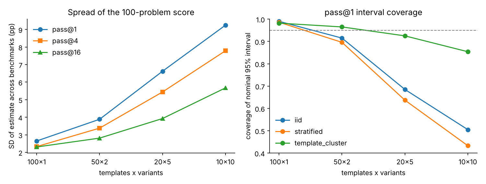

# GSM-Symbolic: templates vs variants (Qwen2.5-Math-1.5B-Instruct, 64 attempts per problem)

Reproduce (CPU, ~40 s):
```bash
python scripts/analysis/template_tiers.py --counts results/gsm_symbolic_qwen2.5-math-1.5b/counts.csv --out results/gsm_symbolic_qwen2.5-math-1.5b/tiers
python scripts/analysis/plot_template_tiers.py --dir results/gsm_symbolic_qwen2.5-math-1.5b/tiers
```

## Data

| item | value |
|---|---|
| problems | apple/GSM-Symbolic main (100 templates), P1 (100), P2 (50); first 20 variants each → 5,000; all present, 20 per template |
| attempts | N = 64 per problem, same sampling as MATH-500 (T 0.6, top-p 0.95, 2,048 tokens); math-verify grading |
| pass@1 | main 0.807, P1 0.708, P2 0.532 |
| 0/64 correct | main 2.6%, P1 4.3%, P2 3.4% |
| between-template share of variance in per-variant success rate | main 0.75, P1 0.74, P2 0.84 |
| run | one g5.xlarge spot; pilot 6,400 generations in 11 min; full run ~9 h with two spot reclaims, resumed from S3 |

Pilot grading check: zero-score problems inspected by hand were model errors (e.g. 609/725 computed as 83.6% instead
of 84%), not extraction failures; 1% of answers have no extractable answer (mostly runaway repetition, graded wrong).
One problem (main/t076/i09, all 64 answers = 219) could not be checked against the question text.

## Design

Each draw is a 100-problem benchmark with fixed composition 40 main / 30 P1 / 30 P2, spread over
100×1, 50×2, 20×5 or 10×10 templates × variants (templates without replacement within level, variants without
replacement within template), n = 16 of the 64 attempts per problem. Target fixed in advance:
0.4·pass@k(main) + 0.3·pass@k(P1) + 0.3·pass@k(P2) over the full pool from all 64 attempts. Chen estimator,
1,000 draws, 1,000 bootstrap resamples, 95% percentile intervals.

## Results

SD of the 100-problem estimate across draws (pp); bias is below 0.7 pp everywhere:

| tier | pass@1 | pass@4 | pass@8 | pass@16 |
|---|---|---|---|---|
| 100×1 | 2.65 | 2.33 | 2.23 | 2.31 |
| 50×2 | 3.88 | 3.38 | 3.04 | 2.81 |
| 20×5 | 6.62 | 5.44 | 4.61 | 3.93 |
| 10×10 | 9.24 | 7.79 | 6.65 | 5.67 |

Coverage of nominal 95% intervals, pass@1 (pass@16 in brackets):

| tier | iid | stratified by level | template cluster |
|---|---|---|---|
| 100×1 | 0.99 (0.95) | 0.99 (0.94) | 0.98 (0.94) |
| 50×2 | 0.92 (0.90) | 0.90 (0.90) | 0.97 (0.92) |
| 20×5 | 0.69 (0.75) | 0.64 (0.75) | 0.93 (0.82) |
| 10×10 | 0.51 (0.56) | 0.43 (0.55) | 0.85 (0.70) |

Mean width at pass@1: iid ~13.4–13.8 pp in every tier; template cluster 13.0 / 16.9 / 23.8 / 29.4 pp.



## Reading

* With the same number of problems, attempts and difficulty mix, concentrating the benchmark on fewer templates makes
  the score 3.5× more variable at pass@1 (2.65 → 9.24 pp) and 2.5× at pass@16. Templates explain about three quarters of
  the variance in per-variant success, so variants of one template add little new information.
* The iid interval does not see this: its width stays ~13.5 pp while the true spread grows, so coverage falls from 0.99
  to 0.51. Stratifying by difficulty does not help (it is slightly worse).
* Resampling whole templates restores most of the coverage at 50×2 and 20×5 but still undercovers at 10×10 (3–4
  templates per level are too few for a cluster bootstrap) and at larger k.
* 100×1 over-covers slightly because 40 of 100 main templates are drawn without replacement (finite pool).

Wording for the paper: *on GSM-Symbolic, at a fixed 100-problem budget and difficulty mix, spreading problems over more
templates made the pass@k estimate markedly less variable, and iid intervals covered the target only when each template
contributed one or two problems.* This is one model and one benchmark; SWE-bench (repositories as sources) is next.
